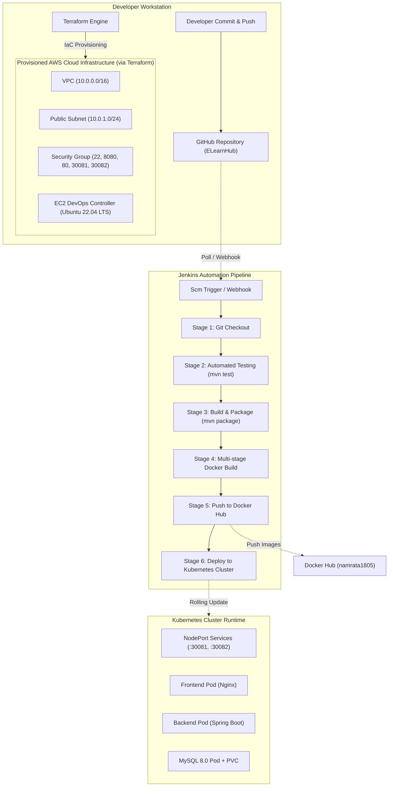

# Jenkins CI/CD & Terraform Infrastructure as Code
## Mini Project Submission Report

---

| Field | Details |
|---|---|
| **Assignment Title** | Jenkins CI/CD + Terraform Mini Project |
| **Student Name** | Namrata Bhadane |
| **Docker Hub Registry** | [namrata1805](https://hub.docker.com/u/namrata1805) |
| **GitHub Repository** | [https://github.com/nambhadane/elearn-jenkins](https://github.com/nambhadane/elearn-jenkins) |
| **Date of Submission** | October 2026 |

---

## Table of Contents
1. [Executive Summary](#1-executive-summary)
2. [End-to-End DevOps Architecture](#2-end-to-end-devops-architecture)
3. [Part A: Jenkins CI/CD Pipeline](#3-part-a-jenkins-cicd-pipeline)
   - 3.1 Pipeline Overview & Strategy
   - 3.2 Jenkinsfile Code Listing
   - 3.3 Stage-by-Stage Explanation
4. [Part B: Terraform Infrastructure as Code](#4-part-b-terraform-infrastructure-as-code)
   - 4.1 IaC Concepts & Resource Strategy
   - 4.2 Configuration Code Listings
   - 4.3 Automated Bootstrap (User-Data)
5. [Part C: Execution Evidence & Screenshots Guide](#5-part-c-execution-evidence--screenshots-guide)
6. [Part D: Key DevOps & Cloud-Native Concepts](#6-part-d-key-devops--cloud-native-concepts)
7. [Part E: Spoken Video Demonstration Script](#7-part-e-spoken-video-demonstration-script)
8. [Conclusion](#8-conclusion)

---

## 1. Executive Summary

Modern cloud-native engineering requires two foundational pillars:
1. **Automated Continuous Integration and Continuous Deployment (CI/CD)** to validate, build, containerize, and deploy software changes without manual intervention.
2. **Infrastructure as Code (IaC)** to provision, version, and manage reproducible computing infrastructure deterministically.

In this mini-project, an automated end-to-end DevOps pipeline was engineered for the **E-LearnHub** application. A declarative multi-stage **Jenkins pipeline** manages source checkout, automated unit testing, application packaging, Docker containerization, Docker Hub artifact publishing, and automated rolling deployment into a **Kubernetes** cluster. In parallel, **Terraform** configurations define and provision the underlying cloud infrastructure (VPC, Subnet, Security Groups, and an EC2 DevOps controller instance pre-configured with Docker, Jenkins, and Kubernetes tooling).

---

## 2. End-to-End DevOps Architecture



---

## 3. Part A: Jenkins CI/CD Pipeline

### 3.1 Pipeline Overview & Strategy

The pipeline follows the **Declarative Pipeline** model, which offers structured syntax, built-in error handling, options blocks, and clean post-execution hooks.

Key architectural characteristics:
- **Build Isolation:** Builds both the backend REST service and the frontend web app.
- **Fail-Fast Testing:** Automated unit tests execute before any container is built. If tests fail, the build halts immediately, preventing defective builds from reaching registry or production.
- **Credential Masking:** Docker Hub credentials are kept secret using Jenkins `withCredentials` block and injected securely via environment variables (`DH_USER`, `DH_PASS`).
- **Zero-Downtime Rollout:** Kubernetes rolling deployment triggers (`kubectl rollout restart` and `kubectl rollout status`) ensure seamless updates.

---

### 3.2 Jenkinsfile Code Listing

File location: `E-LearnHub/Jenkinsfile`

```groovy
pipeline {
    agent any

    environment {
        DOCKERHUB_CREDENTIALS_ID = 'dockerhub-credentials'
        DOCKERHUB_USERNAME       = 'namrata1805'
        BACKEND_IMAGE            = "${DOCKERHUB_USERNAME}/elearnhub-backend"
        FRONTEND_IMAGE           = "${DOCKERHUB_USERNAME}/elearnhub-frontend"
        BUILD_TAG                = "${BUILD_NUMBER}"
    }

    options {
        timestamps()
        timeout(time: 30, unit: 'MINUTES')
        disableConcurrentBuilds()
    }

    stages {

        // ==========================================
        // Stage 1: Automated Source Code Integration
        // ==========================================
        stage('Checkout Source Code') {
            steps {
                echo '=== Stage 1: Pulling latest code from GitHub ==='
                checkout scmGit(
                    branches: [[name: '*/main']],
                    extensions: [],
                    userRemoteConfigs: [[url: 'https://github.com/nambhadane/elearn-jenkins.git']]
                )
            }
        }

        // ==========================================
        // Stage 2: Automated Testing (Backend Unit Tests)
        // ==========================================
        stage('Automated Tests') {
            steps {
                echo '=== Stage 2: Running Unit & Integration Tests ==='
                dir('Backend/teacher-service') {
                    bat 'mvn test'
                }
            }
            post {
                always {
                    junit testResults: 'Backend/teacher-service/target/surefire-reports/*.xml', allowEmptyResults: true
                }
            }
        }

        // ==========================================
        // Stage 3: Application Build & Artifact Packaging
        // ==========================================
        stage('Build & Package') {
            steps {
                echo '=== Stage 3: Compiling Application & Generating JAR ==='
                dir('Backend/teacher-service') {
                    bat 'mvn clean package -DskipTests'
                }
            }
        }

        // ==========================================
        // Stage 4: Docker Container Image Build
        // ==========================================
        stage('Build Docker Images') {
            steps {
                echo '=== Stage 4: Building Multi-Stage Docker Images ==='
                script {
                    bat "docker build -t ${BACKEND_IMAGE}:${BUILD_TAG} -t ${BACKEND_IMAGE}:latest ."
                    bat "docker build --build-arg VITE_API_BASE_URL=http://localhost:8082 -t ${FRONTEND_IMAGE}:${BUILD_TAG} -t ${FRONTEND_IMAGE}:latest frontend/eduflow-hub"
                }
            }
        }

        // ==========================================
        // Stage 5: Push Images to Docker Hub Registry
        // ==========================================
        stage('Push Images to Docker Hub') {
            steps {
                echo '=== Stage 5: Publishing Images to Docker Hub ==='
                script {
                    withCredentials([usernamePassword(credentialsId: "${DOCKERHUB_CREDENTIALS_ID}", 
                                                      usernameVariable: 'DH_USER', 
                                                      passwordVariable: 'DH_PASS')]) {
                        bat 'echo %DH_PASS% | docker login -u %DH_USER% --password-stdin'
                        
                        bat "docker push ${BACKEND_IMAGE}:${BUILD_TAG}"
                        bat "docker push ${BACKEND_IMAGE}:latest"
                        
                        bat "docker push ${FRONTEND_IMAGE}:${BUILD_TAG}"
                        bat "docker push ${FRONTEND_IMAGE}:latest"
                    }
                }
            }
        }

        // ==========================================
        // Stage 6: Continuous Deployment to Kubernetes
        // ==========================================
        stage('Deploy to Kubernetes') {
            steps {
                echo '=== Stage 6: Deploying Application to Kubernetes Cluster ==='
                script {
                    bat 'kubectl apply -f k8s/mysql-secret.yaml'
                    bat 'kubectl apply -f k8s/mysql-pvc.yaml'
                    bat 'kubectl apply -f k8s/mysql-deployment.yaml'
                    bat 'kubectl apply -f k8s/backend-deployment.yaml'
                    bat 'kubectl apply -f k8s/frontend-deployment.yaml'
                    
                    bat 'kubectl rollout restart deployment backend-deployment'
                    bat 'kubectl rollout restart deployment frontend-deployment'
                    
                    bat 'kubectl rollout status deployment/backend-deployment --timeout=120s'
                    bat 'kubectl rollout status deployment/frontend-deployment --timeout=120s'
                }
            }
        }
    }

    post {
        always {
            echo '=== Pipeline Execution Completed ==='
            bat 'kubectl get pods'
            bat 'kubectl get services'
        }
        success {
            echo "SUCCESS: E-LearnHub CI/CD Pipeline Build #${BUILD_NUMBER} completed and deployed successfully! 🚀"
        }
        failure {
            echo "FAILURE: E-LearnHub CI/CD Pipeline Build #${BUILD_NUMBER} failed. Check stage logs for details. ❌"
        }
    }
}
```

---

### 3.3 Stage-by-Stage Explanation

| Stage | Purpose | Implementation Detail |
|---|---|---|
| **1. Checkout Source Code** | Clones the designated GitHub repository branch | Pulls from `main` of `https://github.com/nambhadane/elearn-jenkins.git`. |
| **2. Automated Tests** | Executes automated testing suites | Runs `mvn test`. Uses the Jenkins `junit` test-archiver plugin to graph test trends in the Jenkins UI. |
| **3. Build & Package** | Compiles source files and creates standalone artifacts | Runs `mvn clean package -DskipTests` to generate `app.jar`. |
| **4. Build Docker Images** | Builds multi-stage container images | Dual tags images: with `:BUILD_NUMBER` for immutable trace history and `:latest` for active deployment. |
| **5. Push Images to Docker Hub** | Uploads container images to public registry | Securely reads token credentials from Jenkins store and pushes to `namrata1805` account. |
| **6. Deploy to Kubernetes** | Applies manifests and triggers zero-downtime rollout | Executes `kubectl apply -f k8s/` manifests followed by `kubectl rollout restart` and status tracking. |

---

## 4. Part B: Terraform Infrastructure as Code

### 4.1 IaC Concepts & Resource Strategy

Infrastructure as Code allows operators to describe complete cloud topologies in declarative configuration files rather than clicking through graphical web consoles.

**Key Advantages:**
1. **Idempotency:** Running `terraform apply` multiple times produces the exact state without duplicating resources.
2. **Execution Plans (`terraform plan`):** Provides a preview diff of changes before committing any cloud modifications.
3. **State Tracking (`terraform.tfstate`):** Maintains a single source of truth mapping declared resources to physical cloud IDs.

---

### 4.2 Configuration Code Listings

#### `terraform/provider.tf`
Configures the HashiCorp AWS provider with centralized tags:
```hcl
terraform {
  required_version = ">= 1.0.0"

  required_providers {
    aws = {
      source  = "hashicorp/aws"
      version = "~> 5.0"
    }
  }
}

provider "aws" {
  region = var.aws_region

  default_tags {
    tags = {
      Project     = "E-LearnHub"
      Environment = "DevOps-Assignment"
      ManagedBy   = "Terraform"
      Owner       = "Namrata-Bhadane"
    }
  }
}
```

#### `terraform/variables.tf`
Defines parameters for customization across environments:
```hcl
variable "aws_region" {
  description = "AWS deployment region"
  type        = string
  default     = "ap-south-1"
}

variable "instance_type" {
  description = "EC2 instance sizing suitable for Docker, Jenkins, and Kubernetes"
  type        = string
  default     = "t3.medium"
}

variable "key_name" {
  description = "Name of existing AWS EC2 Key Pair for SSH access"
  type        = string
  default     = "elearnhub-key"
}

variable "vpc_cidr" {
  description = "CIDR block for the dedicated E-LearnHub VPC"
  type        = string
  default     = "10.0.0.0/16"
}

variable "subnet_cidr" {
  description = "CIDR block for the public subnet"
  type        = string
  default     = "10.0.1.0/24"
}

variable "allowed_ssh_ip" {
  description = "IP CIDR allowed to connect via SSH"
  type        = string
  default     = "0.0.0.0/0"
}
```

#### `terraform/main.tf`
Provisions networking, security firewall, and EC2 instance with automated initialization:
```hcl
# 1. Dedicated VPC
resource "aws_vpc" "elearnhub_vpc" {
  cidr_block           = var.vpc_cidr
  enable_dns_hostnames = true
  enable_dns_support   = true

  tags = { Name = "elearnhub-vpc" }
}

# 2. Internet Gateway
resource "aws_internet_gateway" "elearnhub_igw" {
  vpc_id = aws_vpc.elearnhub_vpc.id

  tags = { Name = "elearnhub-igw" }
}

# 3. Public Subnet
resource "aws_subnet" "public_subnet" {
  vpc_id                  = aws_vpc.elearnhub_vpc.id
  cidr_block              = var.subnet_cidr
  map_public_ip_on_launch = true
  availability_zone       = "${var.aws_region}a"

  tags = { Name = "elearnhub-public-subnet" }
}

# 4. Route Table
resource "aws_route_table" "public_rt" {
  vpc_id = aws_vpc.elearnhub_vpc.id

  route {
    cidr_block = "0.0.0.0/0"
    gateway_id = aws_internet_gateway.elearnhub_igw.id
  }

  tags = { Name = "elearnhub-public-rt" }
}

resource "aws_route_table_association" "public_assoc" {
  subnet_id      = aws_subnet.public_subnet.id
  route_table_id = aws_route_table.public_rt.id
}

# 5. Security Group
resource "aws_security_group" "elearnhub_sg" {
  name        = "elearnhub-security-group"
  description = "Security group for Jenkins CI/CD, Kubernetes, and E-LearnHub services"
  vpc_id      = aws_vpc.elearnhub_vpc.id

  ingress {
    description = "SSH Access"
    from_port   = 22
    to_port     = 22
    protocol    = "tcp"
    cidr_blocks = [var.allowed_ssh_ip]
  }

  ingress {
    description = "Jenkins Web UI"
    from_port   = 8080
    to_port     = 8080
    protocol    = "tcp"
    cidr_blocks = ["0.0.0.0/0"]
  }

  ingress {
    description = "Kubernetes Frontend NodePort"
    from_port   = 30081
    to_port     = 30081
    protocol    = "tcp"
    cidr_blocks = ["0.0.0.0/0"]
  }

  ingress {
    description = "Kubernetes Backend NodePort"
    from_port   = 30082
    to_port     = 30082
    protocol    = "tcp"
    cidr_blocks = ["0.0.0.0/0"]
  }

  egress {
    from_port   = 0
    to_port     = 0
    protocol    = "-1"
    cidr_blocks = ["0.0.0.0/0"]
  }
}

# 6. EC2 Instance
resource "aws_instance" "devops_server" {
  ami                         = "ami-053b12d3152c0cc71" # Ubuntu 22.04 LTS
  instance_type               = var.instance_type
  subnet_id                   = aws_subnet.public_subnet.id
  vpc_security_group_ids      = [aws_security_group.elearnhub_sg.id]
  key_name                    = var.key_name
  associate_public_ip_address = true

  root_block_device {
    volume_size = 30
    volume_type = "gp3"
  }

  user_data = <<-EOF
              #!/bin/bash
              set -e
              apt-get update -y && apt-get install -y git openjdk-17-jdk docker.io
              systemctl enable docker && systemctl start docker
              curl -fsSL https://pkg.jenkins.io/debian-stable/jenkins.io-2023.key | tee /usr/share/keyrings/jenkins-keyring.asc > /dev/null
              echo deb [signed-by=/usr/share/keyrings/jenkins-keyring.asc] https://pkg.jenkins.io/debian-stable binary/ | tee /etc/apt/sources.list.d/jenkins.list > /dev/null
              apt-get update -y && apt-get install -y jenkins
              usermod -aG docker jenkins && systemctl restart jenkins
              EOF

  tags = {
    Name = "elearnhub-devops-jenkins-server"
  }
}
```

#### `terraform/outputs.tf`
Outputs connection coordinates upon successful apply:
```hcl
output "instance_public_ip" {
  description = "Public IP address of the DevOps Jenkins server"
  value       = aws_instance.devops_server.public_ip
}

output "jenkins_url" {
  description = "Direct URL to access the Jenkins Web Dashboard"
  value       = "http://${aws_instance.devops_server.public_ip}:8080"
}

output "elearnhub_frontend_k8s_url" {
  description = "Access URL for E-LearnHub Frontend application via NodePort"
  value       = "http://${aws_instance.devops_server.public_ip}:30081"
}
```

---

## 5. Part C: Execution Evidence & Screenshots Guide

This section contains the complete execution evidence for the project. For each step, follow the instructions below to capture the screenshot and insert it into the designated placeholder.

---

### Screenshot 1: Declarative Jenkinsfile Configuration
- **Purpose:** Demonstrates the multi-stage declarative pipeline syntax stored in version control alongside the source code.
- **How to capture:** Open `E-LearnHub/Jenkinsfile` in VS Code or your code editor.
- **What must be visible:** The pipeline block showing the stages (`Checkout Source Code`, `Automated Tests`, `Build & Package`, `Build Docker Images`, `Push Images to Docker Hub`, and `Deploy to Kubernetes`).

> **[INSERT SCREENSHOT 1 HERE]**  
> *(Capture: VS Code editor displaying `Jenkinsfile`)*

---

### Screenshot 2: Jenkins Pipeline Job Configuration
- **Purpose:** Proves that the Jenkins pipeline is linked directly to your GitHub repository using Pipeline script from SCM.
- **How to capture:** In Jenkins Dashboard, navigate to your Pipeline job, click **Configure**, and scroll down to the **Pipeline** section.
- **What must be visible:** 
  - Definition: `Pipeline script from SCM`
  - SCM: `Git`
  - Repository URL: `https://github.com/nambhadane/elearn-jenkins.git`
  - Branch Specifier: `*/main`
  - Script Path: `Jenkinsfile`

> **[INSERT SCREENSHOT 2 HERE]**  
> *(Capture: Jenkins job configuration page showing GitHub repository URL)*

---

### Screenshot 3: Jenkins Pipeline Stage View (Successful Build)
- **Purpose:** Verifies that all stages executed sequentially and passed successfully.
- **How to capture:** Open the main page of your Jenkins Pipeline job.
- **What must be visible:** The **Stage View** matrix showing all 6 stages highlighted in **green**:
  - `Checkout Source Code`
  - `Automated Tests`
  - `Build & Package`
  - `Build Docker Images`
  - `Push Images to Docker Hub`
  - `Deploy to Kubernetes`
  - The build number (e.g., `#1` or `#2`) and overall execution duration.

> **[INSERT SCREENSHOT 3 HERE]**  
> *(Capture: Jenkins Stage View showing all stages green and successful)*

---

### Screenshot 4: Jenkins Console Output (Deployment & Post-Build Actions)
- **Purpose:** Demonstrates the detailed build execution log and post-build success notification.
- **How to capture:** In Jenkins UI, click on the successful build number (e.g., `#1`), then click **Console Output** and scroll to the bottom.
- **What must be visible:**
  - The execution of `kubectl apply` and `kubectl rollout restart`.
  - The final post-action message: `SUCCESS: E-LearnHub CI/CD Pipeline Build completed and deployed successfully! 🚀`
  - `Finished: SUCCESS` at the very end.

> **[INSERT SCREENSHOT 4 HERE]**  
> *(Capture: Jenkins Console Output showing end of build log and SUCCESS message)*

---

### Screenshot 5: Docker Hub Registry with Published Images
- **Purpose:** Confirms that the CI/CD pipeline built and pushed the container images to the external container registry.
- **How to capture:** Open your browser and go to `https://hub.docker.com/u/namrata1805`.
- **What must be visible:** 
  - Both repositories: `namrata1805/elearnhub-backend` and `namrata1805/elearnhub-frontend`.
  - Inside each repository, the tags list showing `:latest` and the specific build tag `:<build-number>` recently pushed.

> **[INSERT SCREENSHOT 5 HERE]**  
> *(Capture: Docker Hub profile showing both E-LearnHub repositories and tags)*

---

### Screenshot 6: Kubernetes Pods and Services Running in Cluster
- **Purpose:** Proves that the pipeline successfully triggered the deployment and all application pods and services are active in Kubernetes.
- **How to capture:** Open your terminal or PowerShell and run:
  ```powershell
  kubectl get pods -o wide
  kubectl get services
  ```
- **What must be visible:**
  - Pods: `backend-deployment-xxx`, `frontend-deployment-xxx`, and `mysql-deployment-xxx` with Status `Running` (1/1 Ready).
  - Services: `frontend-service` (NodePort `30081`), `backend-service` (NodePort `30082`), and `mysql-service` (ClusterIP `3306`).

> **[INSERT SCREENSHOT 6 HERE]**  
> *(Capture: Terminal output showing all Kubernetes pods Running and NodePort services)*

---

### Screenshot 7: Live Application Accessible via Browser
- **Purpose:** Validates end-to-end functionality proving that users can access the deployed application through the Kubernetes NodePort.
- **How to capture:** Open your web browser and navigate to `http://localhost:30081` (or your Minikube service URL).
- **What must be visible:**
  - The E-LearnHub user interface / dashboard loaded in the browser.
  - The browser address bar showing port `30081`.

> **[INSERT SCREENSHOT 7 HERE]**  
> *(Capture: Web browser showing live E-LearnHub application on NodePort 30081)*

---

### Screenshot 8: Terraform Code Structure and Files
- **Purpose:** Demonstrates the modular organization of Infrastructure as Code.
- **How to capture:** Open VS Code showing the expanded `terraform/` directory in the file explorer.
- **What must be visible:**
  - `terraform/provider.tf`
  - `terraform/variables.tf`
  - `terraform/main.tf`
  - `terraform/outputs.tf`
  - `terraform/terraform.tfvars.example`

> **[INSERT SCREENSHOT 8 HERE]**  
> *(Capture: VS Code explorer displaying the terraform directory structure)*

---

### Screenshot 9: Terraform Initialization (`terraform init`)
- **Purpose:** Demonstrates Terraform downloading and configuring the required AWS cloud provider plugins.
- **How to capture:** In PowerShell or terminal, navigate to the terraform directory and run:
  ```powershell
  cd D:\ELearnHub\E-LearnHub\terraform
  terraform init
  ```
- **What must be visible:**
  - Provider initialization lines for `hashicorp/aws`.
  - The green confirmation message: `"Terraform has been successfully initialized!"`

> **[INSERT SCREENSHOT 9 HERE]**  
> *(Capture: Terminal showing successful terraform init output)*

---

### Screenshot 10: Terraform Execution Plan (`terraform plan`)
- **Purpose:** Demonstrates Terraform’s declarative planning phase showing the exact cloud resources that will be provisioned.
- **How to capture:** In the terraform directory, run:
  ```powershell
  terraform plan
  ```
- **What must be visible:**
  - The list of resources to be created (`aws_vpc`, `aws_subnet`, `aws_internet_gateway`, `aws_route_table`, `aws_security_group`, and `aws_instance`).
  - The summary line at the bottom: `"Plan: 7 to add, 0 to change, 0 to destroy."`

> **[INSERT SCREENSHOT 10 HERE]**  
> *(Capture: Terminal showing terraform plan execution and resource summary)*

---

## 6. Part D: Key DevOps & Cloud-Native Concepts

### 1. Shift-Left Testing in CI/CD
By embedding automated unit tests (`mvn test`) directly inside Stage 2 of the Jenkins pipeline, bugs and regression errors are detected at the earliest point in the software lifecycle ("shifting left"). Code with breaking defects is halted before Docker images are ever constructed.

### 2. Declarative vs. Imperative CI/CD
- **Imperative:** Series of ad-hoc manual scripts (`ssh into server`, `docker run...`). Error-prone, hard to trace, and machine-dependent.
- **Declarative (`Jenkinsfile`):** Version-controlled blueprint declaring desired stages, preconditions, credentials, and post-actions directly alongside application code in Git.

### 3. Infrastructure as Code (IaC) & Idempotency
With Terraform, cloud resources are defined in declarative HCL files. Terraform’s execution engine evaluates the difference between the actual cloud state (`terraform.tfstate`) and the configuration code. It applies only the required changes to reach the declared state, preventing drift and duplicate resources.

### 4. Immutable Artifact Strategy
In Stage 4 and 5, Docker images are stamped with both the unique `${BUILD_NUMBER}` and `:latest`. This creates an immutable historical ledger in Docker Hub, allowing instant rollbacks to any prior version.

---

## 7. Part E: Spoken Video Demonstration Script

*(Read at a calm, natural pace for your 4–5 minute video demonstration)*

---

### 🎙️ Scene 1: Introduction (Camera / Screen sharing VS Code)
> *"Hello everyone and respected faculty. My name is **Namrata Bhadane**, and this is my demonstration for the **Jenkins CI/CD + Terraform Mini Project**.*
>
> *In our previous assignment, we successfully containerized our full-stack application **E-LearnHub** and deployed it onto Kubernetes. Today, we are taking our DevOps workflow to the next level by automating the entire lifecycle:*
> 1. *First, implementing an automated **CI/CD pipeline using Jenkins** that tests, builds, packages, containerizes, pushes images, and deploys to Kubernetes.*
> 2. *Second, using **Terraform** as Infrastructure as Code to provision cloud infrastructure and resources deterministically."*

---

### 🎙️ Scene 2: Jenkins Pipeline Explanation (Show `Jenkinsfile`)
> *"Here on screen is our declarative `Jenkinsfile` stored directly inside our Git repository root.*
>
> *It contains six structured stages:*
> - *In **Stage 1**, Jenkins automatically pulls the latest commit from our GitHub repository.*
> - *In **Stage 2**, it enforces quality gates by running automated Maven tests before any container is created.*
> - *In **Stage 3**, it compiles and packages the Spring Boot application into an executable JAR.*
> - *In **Stage 4**, it builds lightweight multi-stage Docker images for both our backend and frontend, tagging them with both the current build number and the latest tag.*
> - *In **Stage 5**, it authenticates securely with Docker Hub using Jenkins credentials and pushes our images to `namrata1805`.*
> - *Finally, in **Stage 6**, it performs an automated rollout to our Kubernetes cluster using `kubectl apply` and monitors rollout status."*

---

### 🎙️ Scene 3: Live Pipeline Execution & Evidence (Show Jenkins UI & Docker Hub)
> *"Now let's switch to the **Jenkins Dashboard**.*
>
> *(Point to Stage View)*  
> *Here in the Pipeline Stage View, you can see all six stages completed with green checkmarks.*
>
> *(Switch to Docker Hub tab)*  
> *And if we check Docker Hub under repository `namrata1805/elearnhub-backend` and `frontend`, our new images are pushed with matching build numbers.*
>
> *(Switch to Terminal)*  
> *Running `kubectl get pods` shows that our Kubernetes cluster has rolled out the latest containers smoothly."*

---

### 🎙️ Scene 4: Terraform Infrastructure as Code (Show `terraform/` folder)
> *"Now let's move to the second part of our project: **Infrastructure as Code using Terraform**.*
>
> *Under the `terraform/` directory, we have modularized our cloud infrastructure:*
> - *`provider.tf` configures AWS with global tags.*
> - *`variables.tf` defines configurable inputs like region and instance types.*
> - *`main.tf` creates a complete isolated VPC, public subnet, internet gateway, and security group rules allowing ports for SSH, Jenkins, and our Kubernetes NodePorts.*
> - *It also provisions an EC2 instance with an automated `user_data` bootstrap script that installs Docker, Jenkins, Git, and kubectl on first boot.*
> - *And `outputs.tf` exposes our public IP and connection URLs.*
>
> *(In terminal, show `terraform init` and `terraform plan`)*  
> *When we execute `terraform plan`, Terraform generates an execution plan showing exactly which 7 resources will be created without manual console clicking."*

---

### 🎙️ Scene 5: Conclusion
> *"In summary, this project demonstrates real-world DevOps practices:*
> - *Automated continuous integration and deployment with Jenkins.*
> - *Predictable, version-controlled Infrastructure as Code with Terraform.*
> - *And automated container orchestration with Docker and Kubernetes.*
>
> *All configuration files, manifests, and documentation are committed to GitHub. Thank you for your time!"*

---

## 8. Conclusion

This project successfully bridges software delivery and infrastructure operations. By uniting **Jenkins** automated pipeline execution with **Terraform** declarative resource provisioning, the entire lifecycle of the E-LearnHub application—from code commit to live Kubernetes deployment on cloud infrastructure—is completely automated, reproducible, and cloud-native.
